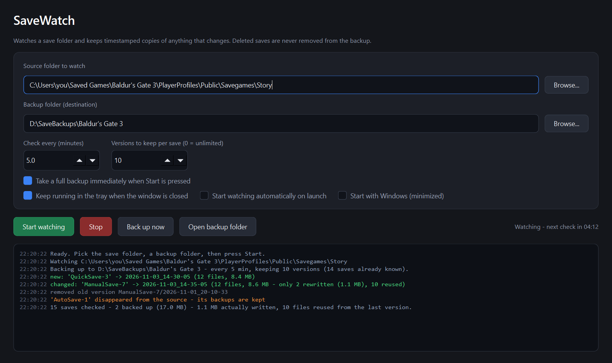

# SaveWatch
Watcher for game save folders. Point it at a game's save directory and a backup folder; every few minutes it re-scans and copies each save that changed into a new timestamped version. Deleted saves are **never** removed from the backup, so an overwritten quick-save or a corrupted slot is always one copy away.
This helps prevent corrupt save games or lost due to power failures or crashes, or if you want to rewind in choice based games.



## Why

Most games keep a handful of rolling autosaves and silently overwrite them. SaveWatch keeps its own history beside the game:

```
<backup>/
  ManualSave-5/
    2026-09-23_14-30-05/   ← every version is a complete, restorable copy
    2026-09-23_14-35-05/
  QuickSave-1/
    2026-09-23_14-31-12/
  SaveWatch_history.log
```

Restoring is just copying a version folder back over the original.

## Features

- **Change detection by fingerprint**: size and mtime of every file under each save slot, so a 300 MB save folder is scanned in milliseconds.
- **Hard-link dedup**: files that did not change since the last version are hard-linked, not copied. A 250-file slot where one file changed costs one file of disk.
- **Keep-N pruning** per save (0 = unlimited).
- **Never mirrors deletions**; a save that vanishes from the game is flagged, its versions stay.
- **Lock-tolerant**: retries files the game is still writing and moves on, nothing partial is ever left behind (versions are staged and renamed atomically).
- **System tray**: keeps watching when the window is closed, with Start/Stop and Back up now in the tray menu.
- **Start with Windows** (minimized, optional auto-start watching).
- **Command line mode** for scripts and schedulers: `savewatch --cli`.
- All copying runs on a worker thread; the window never freezes.

## Install

**Windows exe** (no Python needed): download `SaveWatch.exe` from the [latest release](https://github.com/PhantomAnas/savewatch/releases/latest) and run it. It is built by GitHub Actions from the tagged source.

**From source** (Windows, macOS, Linux):

```
git clone https://github.com/PhantomAnas/savewatch
cd savewatch
python -m venv .venv && .venv\Scripts\activate      # or: source .venv/bin/activate
pip install -e .
savewatch
```

## Use

1. **Source folder to watch**: the game's save directory (for example `%USERPROFILE%\Saved Games\<game>` or `%LOCALAPPDATA%\<game>\Saved`).
2. **Backup folder**: anywhere outside the source, ideally another drive.
3. Pick the check interval and how many versions to keep per save, then **Start watching**.

Settings are saved to the per-user config directory (on Windows: `%LOCALAPPDATA%\SaveWatch\settings.json`).

### Command line

```
savewatch --cli --source "C:\...\Savegames" --backup "D:\SaveBackups\Game" --interval 5 --keep 10
savewatch --cli --once          # one cycle using the settings saved by the window, then exit
savewatch --cli --once --fresh  # ignore known state and copy every save once
```

Exit code is 0 when the cycle completed without errors.

## Development

```
pip install -e ".[dev]"
pytest                      # engine, config and CLI tests, no display needed
pyinstaller savewatch.spec  # builds dist/SaveWatch.exe
python scripts/make_icon.py # regenerate the icon
python scripts/screenshot.py
```

Layout: `src/savewatch/core.py` is the engine (pure functions, no Qt), `app.py` is the PySide6 window and tray, `cli.py` the command line, `config.py` the settings file, `autostart.py` the Windows Run-key entry.

## Notes

- Hard links need source and backup on an NTFS/ext4-style volume. On exFAT or across different drives SaveWatch silently falls back to full copies.
- The backup folder must not be inside the watched folder (the app refuses, otherwise it would back up its own backups).
- Nothing leaves your machine. No telemetry, no network access.

## License

MIT. PySide6 is used under the LGPL.
