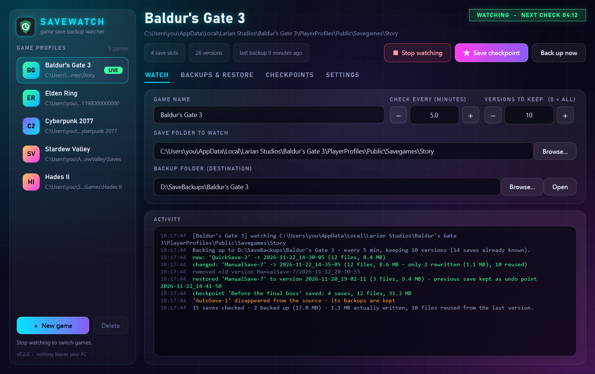
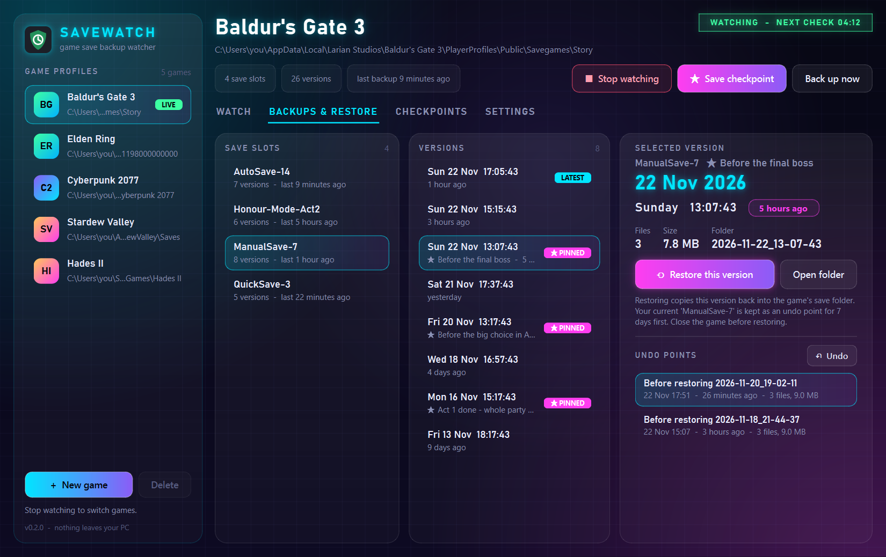
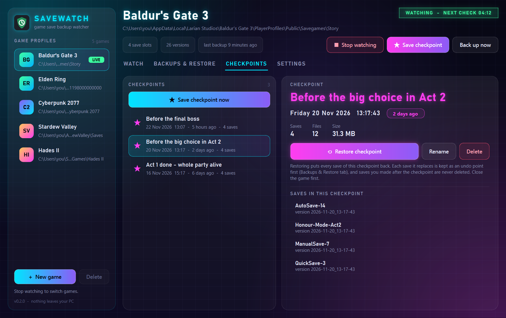
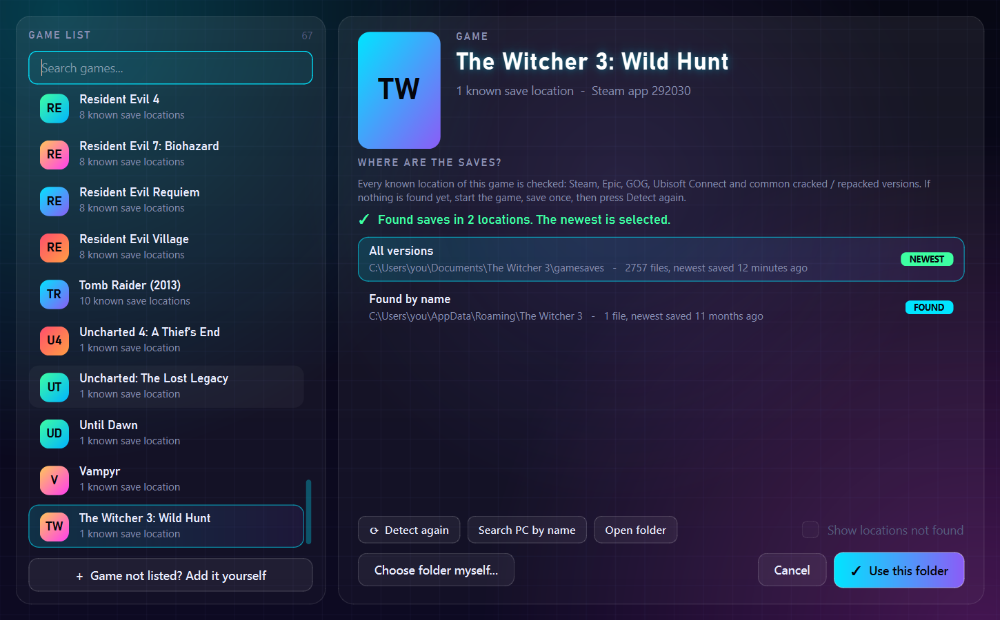

# SaveGameWatcher

**Free, open-source game save backup tool for Windows (Python, PySide6): automatically keeps timestamped versions of your save files so a corrupted, overwritten or deleted save is always one click away. Works with any game that saves to a folder.**

SaveWatch: a versioned backup watcher for game save folders. Give each game a profile (its save folder and a backup folder); every few minutes SaveWatch re-scans and copies each save that changed into a new timestamped version. Deleted saves are **never** removed from the backup, and any version can be put back with one click, with an undo in case you change your mind.
So when a save gets corrupted by a crash or a power cut, or you want to rewind a choice in a story game, the earlier version is still there.







## Why

A save file is often the only record of tens or hundreds of hours of play, and games are surprisingly careless with it. Most keep a handful of rolling autosaves and silently overwrite the oldest one, so by the time you notice a problem, every good copy may already be gone. Common ways saves get lost or ruined:

- **Corruption from crashes and power loss.** If the game crashes, freezes, or the PC loses power (outage, blue screen, a forced shutdown, a laptop battery running out) while a save is being written, the file can end up half written and refuse to load.
- **Bugs and glitches.** A quest that will not trigger, a character stuck in a wall, a broken script or a soft-lock can make a save unplayable, and autosaves keep piling up on top of the broken state.
- **Overwritten by mistake.** Quicksaving a second before dying, saving over the wrong slot, or an autosave firing at the worst possible moment replaces the save you actually wanted.
- **Choices you want to undo.** In story and choice-based games (RPGs, visual novels, narrative adventures), one dialogue option can change the rest of the game. Going back lets you see the other outcome without replaying hours.
- **Character death and hardcore modes.** Permadeath, ironman and "honour" style modes keep a single save and delete or lock it when you die. A backup means one bad fight or a game bug does not cost the whole run. (Whether you use it is up to you.)
- **Going back for something you missed.** Missable items, collectibles, achievements, a companion you lost, or a build you want to redo from an earlier point.
- **Game updates and mods.** A patch can change the save format, and adding or removing mods can break a save or leave it depending on a mod you no longer have. A copy from before the update or mod change is the way back.
- **Cloud sync conflicts.** Steam Cloud and other sync services sometimes replace a newer local save with an older one, or ask you to pick a side in a conflict, and the wrong click wipes your progress.
- **Accidental deletion.** Starting a "new game" on an occupied slot, a clean-up tool, uninstalling a game that keeps its saves in its install folder, or simply deleting the wrong folder.

SaveWatch watches the save folder in the background and keeps its own timestamped history of every save, beside the game rather than inside it. Nothing is ever removed from the backup because it disappeared from the game, and putting any version back is one click (with an undo).

What it keeps on disk:

```
<backup>/
  ManualSave-5/
    2026-09-23_14-30-05/   ← every version is a complete, restorable copy
    2026-09-23_14-35-05/
  QuickSave-1/
    2026-09-23_14-31-12/
  .savewatch_undo/         ← saves replaced by a restore, kept for N days
  .savewatch_checkpoints.json  ← your named checkpoints
  SaveWatch_history.log
```

## Works with any save format

SaveWatch never opens or parses a save file. It copies bytes, so it makes no difference whether a game saves one file, a file plus a screenshot, a folder per slot, or slots plus an index file.

- **Everything in the save folder is backed up**, whatever the file type. Each file or folder directly inside the save folder is treated as one save. A folder is always copied and restored as a whole, with all the files inside it together.
- **Companion files stay together.** Files that share a base name, such as `ManualSave_12.sav` + `ManualSave_12.png` (The Witcher 3) or `slot1.sav` + `slot1.meta`, are restored together, from the same moment, and one Undo reverts them all.
- **Index and profile files.** Some games keep one file that lists every save. For those, use **Restore ALL saves to this moment** (or a checkpoint): every file goes back to the same moment, so the index always matches the saves.
- **One moment per check.** Every file backed up in the same check gets the same timestamp, which is what makes "the same moment" exact.
- **Saves written during the copy.** After copying, each save is checked again. If the game changed it in the meantime, the copy is thrown away and taken again, so a half-old, half-new mix is never kept as the backup.
- **Space saving is lossless.** A file that did not change is stored as a hard link (a second name for the same bytes on disk), not compressed or patched. Every version folder is a complete, normal copy you can open in Explorer.

Not covered: games that keep their saves in the Windows registry or only in the cloud. If a game spreads its saves over several folders, pick the folder that contains all of them as the save folder.

## Features

- **Built-in game list with automatic save-folder detection**: pick a game, SaveWatch checks every known location (Steam, Epic, GOG, Ubisoft Connect, cracked / repacked copies) and shows where your saves really are. Any other game: search the PC by its name.
- **Game profiles**: one profile per game, each with its own save folder, backup folder, check interval and versions to keep. Pick a save folder and the game's name is filled in for you (`...\Documents\The Witcher 3\gamesaves` → *The Witcher 3*).
- **Backups & Restore browser**: every save slot, every version with its date, time and age ("3 hours ago"), file count and size.
- **Safe one-click restore**: the save you have now is copied to an undo point first, the old version is fully copied next to it, then the two are swapped. If the game has a file locked, nothing is changed.
- **Undo** any restore (and undo the undo). Undo points expire after 7 days by default (configurable, or keep forever).
- **Named checkpoints**: press **★ Save checkpoint** before a big story choice or a boss fight, name it ("Before the big choice in Act 2"), and every save is backed up on the spot. Checkpoints are pinned (never pruned by *versions to keep*) and can be restored as a whole later, for example when your character dies or a choice went wrong.
- **Change detection by fingerprint**: size and mtime of every file under each save slot, so a 300 MB save folder is scanned in milliseconds.
- **Hard-link dedup**: files that did not change since the last version are hard-linked, not copied. A 250-file slot where one file changed costs one file of disk.
- **Keep-N pruning** per save (0 = unlimited).
- **Never mirrors deletions**; a save that vanishes from the game is flagged, its versions stay.
- **Lock-tolerant**: retries files the game is still writing and moves on, nothing partial is ever left behind (versions are staged and renamed atomically). A save that changes while it is being copied is copied again.
- **Restore all saves to one moment**: for games with an index or profile file, put every file back the way it was at any backup time, undone with one click.
- **System tray**: keeps watching when the window is closed, with Start/Stop and Back up now in the tray menu.
- **Start with Windows** (minimized, optional auto-start watching).
- **Command line mode** for scripts and schedulers: `savewatch --cli`.
- All copying runs on a worker thread; the window never freezes.

## Install

**Windows exe** (no Python needed): download `SaveWatch.exe` from the [latest release](https://github.com/PhantomAnas/SaveGameWatcher/releases/latest) and run it. It is built by GitHub Actions from the tagged source.

**From source** (Windows, macOS, Linux):

```
git clone https://github.com/PhantomAnas/SaveGameWatcher
cd SaveGameWatcher
python -m venv .venv && .venv\Scripts\activate      # or: source .venv/bin/activate
pip install -e .
savewatch
```

Or skip the install and run `python launcher.py` from the checkout (that Python needs `pip install -r requirements.txt`).

## Use

1. **+ New game** in the sidebar opens the game list. Pick your game and SaveWatch finds its save folder (see below), or choose **Game not listed? Add it yourself**.
2. **Backup folder**: anywhere outside the save folder, ideally another drive. Every game needs its own backup folder; one is suggested next to the ones you already use.
3. Pick the check interval and how many versions to keep per save, then **Start watching**.

### Finding the save folder



SaveWatch ships with a list of games and every known save location for each: Steam, Epic Games, GOG, Ubisoft Connect, the game's install folder in any of your Steam libraries, and the folders that common cracked / repacked copies use (CODEX, RUNE, EMPRESS, OnlineFix, and the Goldberg / GSE Steam emulators found in FitGirl and DODI repacks). Paths are filled in for whoever is logged in: Documents, Saved Games and AppData are looked up from Windows (OneDrive-moved Documents included), Steam and Ubisoft Connect from the registry, and account or profile ID folders are matched automatically.

- Picking a game checks every location and lists the ones that hold files, **newest save first**, with how many files and when the game last wrote to it.
- Nothing found yet? Start the game, **save once**, then press **Detect again**.
- **Search PC by name** looks for folders named after the game in Documents, Saved Games and AppData (`The Witcher 3`, `TheWitcher3`, `witcher_3` all match), preferring a `Saves` / `SaveGames` subfolder inside, and lists the ones holding files.
- **Open folder** lets you look inside before choosing. **Choose folder myself...** is always there.
- For a profile that already exists, **Find saves...** next to the save folder does the same.

Save locations come from [PCGamingWiki](https://www.pcgamingwiki.com) via the [Ludusavi manifest](https://github.com/mtkennerly/ludusavi-manifest). Emulator folders for cracked copies were checked against the emulators' documentation and community reports; groups whose folder layout could not be confirmed (for example voices38, CPY, TENOKE) are not listed, so use **Search PC by name** or **Choose folder myself** for those. Game Pass / Microsoft Store saves are not supported: they live in encrypted containers, not plain files. To add games, edit `GAMES` in `scripts/build_catalog.py` and run it.

### Restoring a save

1. Close the game.
2. Open **Backups & Restore**, pick the save slot, then the version (newest first, with its date and how long ago it was made).
3. **Restore this version**. Your current save is kept as an undo point; it is listed under **Undo points** for that slot. **Undo** puts it back.

### Checkpoints

**★ Save checkpoint** (also in the tray menu) asks for a name and backs up every save in the folder right now. The **Checkpoints** tab lists them with their date and age; **Restore checkpoint** puts every save of that checkpoint back, each replaced save getting its own undo point. Saves you made after the checkpoint are never deleted. Checkpoint versions show up as **★ PINNED** in the versions list too, so a single slot can be restored from one. Deleting a checkpoint only unpins its versions.

Settings (profiles included) are saved to the per-user config directory (on Windows: `%LOCALAPPDATA%\SaveWatch\settings.json`). Settings from 0.1.x are turned into a profile automatically.

### Command line

```
savewatch --cli                                  # watch the profile selected in the window
savewatch --cli --profile "Elden Ring" --once    # one cycle for a named profile, then exit
savewatch --cli --list-profiles
savewatch --cli --profile "Elden Ring" --list    # saves and their versions
savewatch --cli --profile "Elden Ring" --restore ER0000.sl2 --version 2026-11-22_14-30-05
savewatch --cli --profile "Elden Ring" --undo ER0000.sl2
savewatch --cli --profile "Elden Ring" --checkpoint "Before Malenia"
savewatch --cli --profile "Elden Ring" --list-checkpoints
savewatch --cli --profile "Elden Ring" --restore-checkpoint "Before Malenia"
savewatch --cli --source "C:\...\Savegames" --backup "D:\SaveBackups\Game" --interval 5 --keep 10
savewatch --cli --once --fresh                   # ignore known state and copy every save once
```

`--restore` without `--version` restores the newest version. Exit code is 0 on success.

## Development

```
pip install -e ".[dev]"
pytest                      # engine, config and CLI tests, no display needed
pyinstaller savewatch.spec  # builds dist/SaveWatch.exe
python scripts/make_icon.py # regenerate the icon
python scripts/screenshot.py # regenerate the screenshots in docs/
pip install pyyaml && python scripts/build_catalog.py  # rebuild the game list from the Ludusavi manifest
```

Layout: `src/savewatch/core.py` is the engine (backup, restore and undo; pure functions, no Qt), `catalog.py` the game list and save-folder detection (no Qt), `app.py` the PySide6 window and tray, `picker.py` the game picker, `theme.py` the neon stylesheet, `cli.py` the command line, `config.py` the settings file and game profiles, `autostart.py` the Windows Run-key entry. `data/games.json` is generated by `scripts/build_catalog.py`.

## Notes

- Hard links need source and backup on an NTFS/ext4-style volume. On exFAT or across different drives SaveWatch silently falls back to full copies.
- The backup folder must not be inside the watched folder (the app refuses, otherwise it would back up its own backups).
- Restored files are real copies, never hard links, so a game writing to them can never change a backup.
- While a profile is being watched the other profiles are locked; stop watching to switch games.
- No telemetry, and your saves never leave your PC. The only network access is optional: game covers for the game list are downloaded once from Steam's public image server (`cdn.cloudflare.steamstatic.com`) and kept on disk. Turn it off in **Settings** and the app makes no network requests at all.

## License

MIT. PySide6 is used under the LGPL. The save-location data is derived from PCGamingWiki (CC BY-NC-SA 3.0) through the Ludusavi manifest.
